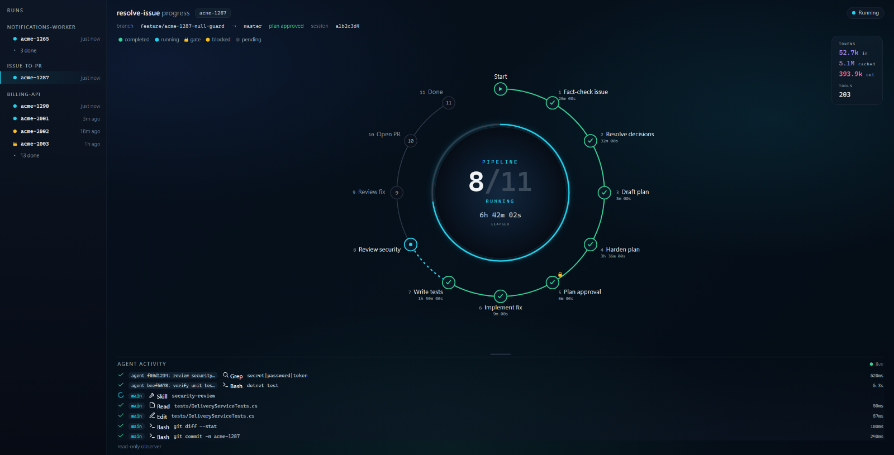
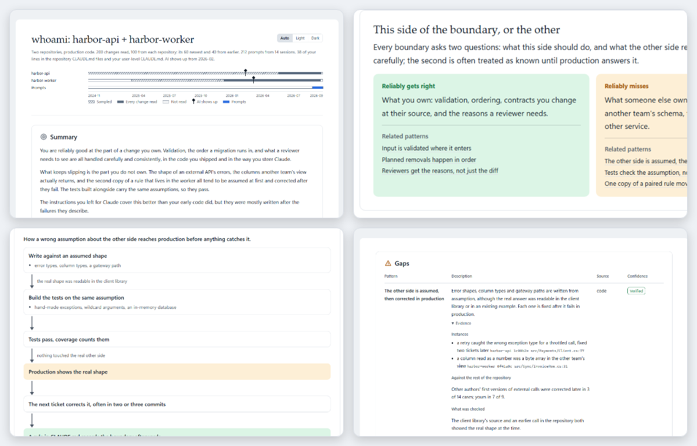
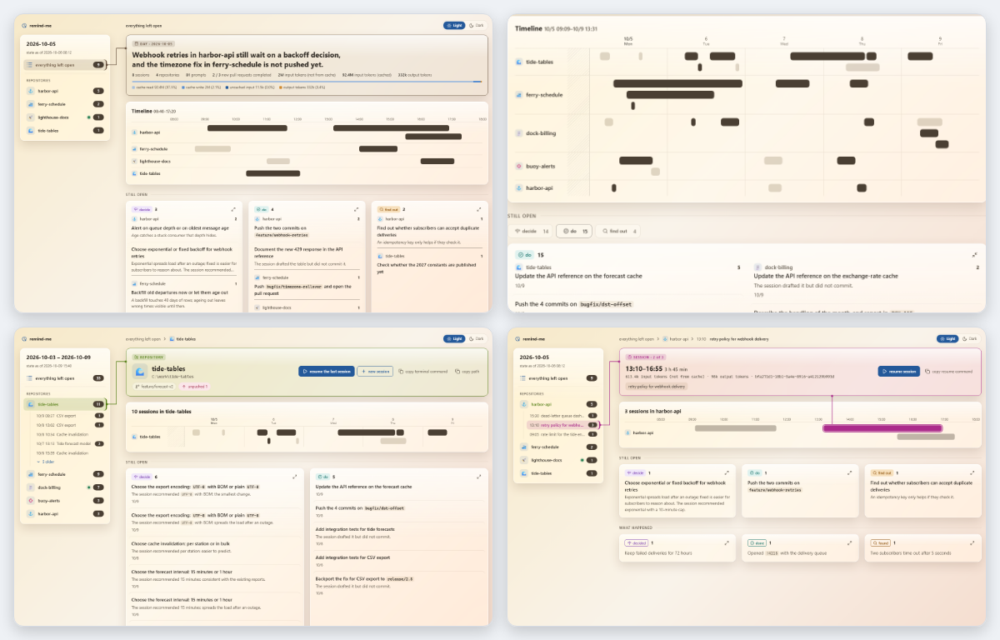

<!-- translated from README.md, source sha256 99d146fe8b60a78a8d75d4e4f528be87de23319f1fb0b775b18bce5cbf865739; see the root CLAUDE.md "Translations" before editing -->
<div align="center">

<picture>
  <source media="(prefers-color-scheme: dark)" srcset="docs/banner/banner-dark.jpg">
  
</picture>

[](#install) [](LICENSE)

[English](README.md) | [繁體中文](README.zh-TW.md) | [简体中文](README.zh-CN.md)

</div>

一个 Claude Code plugin marketplace：收录把工单带到经过审查的 pull request 的 plugin，让你看清自己工作方式的 plugin，以及一个帮你填工时表的 plugin。

<a id="install"></a>
## 📦 安装

```
/plugin marketplace add https://github.com/tundra-east/tundra.git
```

然后从中安装你需要的 plugin：

```
/plugin install <plugin>@tundra
```

之后运行 `/reload-plugins` 来启用它们。

对于这样的 marketplace，Claude Code 默认不开启自动更新，所以在你开启之前都不会收到新版本：`/plugin` → **Marketplaces** → `tundra` → **Enable auto-update**。

请使用上面完整的 HTTPS URL。`tundra-east/tundra` 这种简写也能用，但它通过 SSH clone，是不同的指令。

<a id="what-is-in-it"></a>
## 🗂️ 内容

### 🔁 从工单到 pull request

四个 plugin，把一个工单带到经过审查的 pull request，完整说明在[它们自己的 README](docs/issue-to-pr/README.zh-CN.md)中。`issue-to-pr-pipeline` 运行整个流程；在 Claude Code v2.1.143 或更高版本上，安装它就会一并安装另外三个，而那三个也都可以独立使用。



| Plugin | 做什么 |
|---|---|
| [`issue-to-pr-pipeline`](docs/issue-to-pr/README.zh-CN.md#issue-to-pr-pipeline) | 把一个工单从诊断带到经过审查的 pull request，批准计划前和创建 PR 前各停下来等你一次 |
| [`disconfirm-first`](docs/issue-to-pr/README.zh-CN.md#disconfirm-first) | 在下一步以它为基础之前，对 issue、计划或已实现的修复进行对抗式审查 |
| [`test-authoring`](docs/issue-to-pr/README.zh-CN.md#test-authoring) | 找出测试缺口，编写单元测试和集成测试，每个测试都由独立的验证者检查 |
| [`pr-lifecycle`](docs/issue-to-pr/README.zh-CN.md#pr-lifecycle) | 在 Azure DevOps 或 GitHub 上按你以往 PR 的风格创建 pull request，并处理它的评审意见 |

一次安装全部四个：

```
/plugin install issue-to-pr-pipeline@tundra
```

### 🪞 你的工作方式

#### [`whoami`](plugins/whoami/README.zh-CN.md)

根据你的代码、你的 prompt 和你的 CLAUDE.md 做一份自我评估，输出为 HTML 报告。只有你能用 `/whoami:whoami` 启动它。

<picture>
  <source media="(prefers-color-scheme: dark)" srcset="docs/whoami/thumbnails-dark.png">
  
</picture>

安装命令：

```
/plugin install whoami@tundra
```

#### [`remind-me`](plugins/remind-me/README.zh-CN.md)

你在某一天或一段日期里运行过的 session 还留下哪些没做完的事，逐一对照每个 pull request 和 branch 的实时状态，并提供一键回到每个 session 的链接。

<picture>
  <source media="(prefers-color-scheme: dark)" srcset="docs/remind-me/thumbnails-dark.png">
  
</picture>

安装命令：

```
/plugin install remind-me@tundra
```

### ⏱️ 你的工时表

#### [`tempo-logger`](plugins/tempo-logger/README.zh-CN.md)

根据你说的工作内容填好 Tempo 工时表。


安装命令：

```
/plugin install tempo-logger@tundra
```
