# tempo-logger

[English](README.md) | [繁體中文](README.zh-TW.md) | [简体中文](README.zh-CN.md)

Fill in your Tempo timesheet by saying what you did. Nothing is written until you have seen the table and said yes.

```
> fill in this week with 8 hours of ACME-182
```

```
2026-09-14 to 2026-09-18 — 5 rows across 5 dates
Excluded (weekend): 2 days (09-19 Sat, 09-20 Sun)
4 rows are on a future date (today is 2026-09-14)

  week of 2026-09-14                                 Mon 14  Tue 15  Wed 16  Thu 17  Fri 18
  -----------------------------------------------------------------------------------------
  200-17 · Widget Platform – Development (ACME-182)   +8.00   +8.00   +8.00   +8.00   +8.00
  day total                                            8.00    8.00    8.00    8.00    8.00
```

Say yes, and that is the week in Tempo:

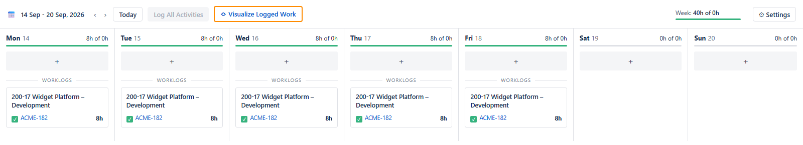

The week views on this page are mock-ups drawn in Tempo's layout, with made-up work items and accounts, not screenshots of a real timesheet. The table above each one shows the plugin's own layout for the same made-up history.

---

## How it works

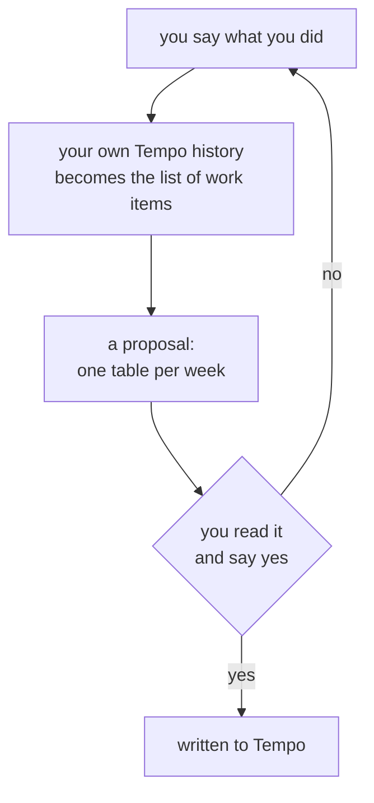

The table is the whole safety mechanism. It shows every day it touches, what each work item comes to, and what the day adds up to — so a day quietly becoming sixteen hours is visible before it happens, not after.

---

## Installing

This plugin is published from the `tundra` marketplace.

```
/plugin marketplace add https://github.com/tundra-east/tundra.git
/plugin install tempo-logger@tundra
```

---

## Setup

One step, and it starts in the Tempo UI. Open **Tempo** from the Jira sidebar, then **Settings** at the foot of the Tempo panel. Under **Data access** choose **API Integration**, then **+ New Token**.

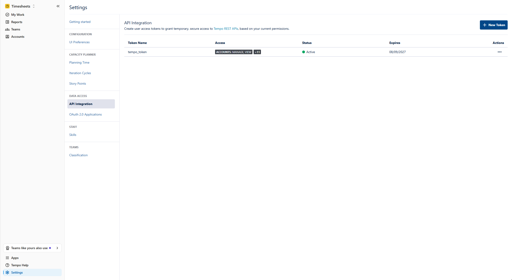

Unlike the week views on this page, this picture is a crop of the real Tempo settings panel.

Save the token it gives you as the only line of a plain text file:

| Platform | Token file |
|---|---|
| Linux, macOS | `~/.config/tempo/token.txt` |
| Windows | `%APPDATA%\tempo\token.txt` |

Then ask, in the same place you ask for everything else:

```
> check my tempo setup
```

It answers `ready`, or names exactly what is missing — including an empty timesheet, which is the one thing it cannot settle for you. Tempo has no endpoint that says who a token belongs to, so your account id is read off a worklog you have already logged; with none, not even a read can run. Log one entry in the Tempo UI and everything after that works from your history.

---

## What you can say

Name a work item however you have it to hand — its Jira key `ACME-182`, its account key `200-17`, or its title `Widget Platform – Development`. If more than one matches, you are asked which. Each case below is the command, the table you are asked to confirm, and the week in Tempo once you have.

**Log a whole day, split across work items.** As many as the day takes.

```
> log 7 hours of ACME-182 and 1 hour of ACME-177 every day this week
```

```
2026-09-14 to 2026-09-18 — 10 rows across 5 dates
Excluded (weekend): 2 days (09-19 Sat, 09-20 Sun)
8 rows are on a future date (today is 2026-09-14)

  week of 2026-09-14                                 Mon 14  Tue 15  Wed 16  Thu 17  Fri 18
  -----------------------------------------------------------------------------------------
  200-17 · Widget Platform – Development (ACME-182)   +7.00   +7.00   +7.00   +7.00   +7.00
  200-16 · Widget Platform - Governance (ACME-177)    +1.00   +1.00   +1.00   +1.00   +1.00
  day total                                            8.00    8.00    8.00    8.00    8.00
```

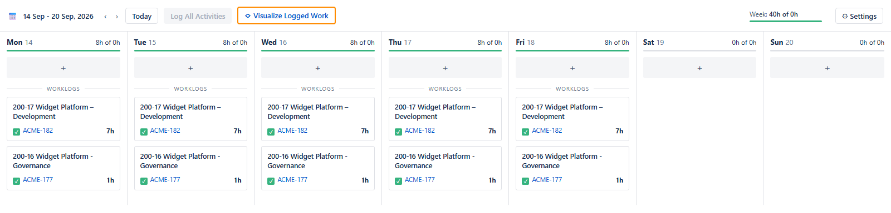

**Name it in your own words.** Matching is not a text search: case, a partial name, a typo or another language all land on the same work item, and anything that could be two of them is put back to you rather than guessed.

```
> log 8 hours on widget dev tomorrow
```

```
2026-09-15 to 2026-09-15 — 1 row across 1 date
1 row is a future date (today is 2026-09-14)

  week of 2026-09-14                                 Mon 14  Tue 15  Wed 16  Thu 17  Fri 18
  -----------------------------------------------------------------------------------------
  200-17 · Widget Platform – Development (ACME-182)           +8.00
  day total                                                    8.00
```

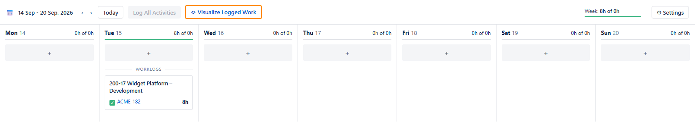

**Fill a longer span.** One table per week, however many weeks it takes.

```
> log 8 hours on Widget Platform – Development for the three weeks after this one
```

```
2026-09-21 to 2026-10-09 — 15 rows across 15 dates
Excluded (weekend): 4 days (09-26 Sat, 09-27 Sun, 10-03 Sat, 10-04 Sun)
15 rows are on a future date (today is 2026-09-14)

  week of 2026-09-21                                 Mon 21  Tue 22  Wed 23  Thu 24  Fri 25
  -----------------------------------------------------------------------------------------
  200-17 · Widget Platform – Development (ACME-182)   +8.00   +8.00   +8.00   +8.00   +8.00
  day total                                            8.00    8.00    8.00    8.00    8.00

  week of 2026-09-28                                 Mon 28  Tue 29  Wed 30  Thu 01  Fri 02
  -----------------------------------------------------------------------------------------
  200-17 · Widget Platform – Development (ACME-182)   +8.00   +8.00   +8.00   +8.00   +8.00
  day total                                            8.00    8.00    8.00    8.00    8.00

  week of 2026-10-05                                 Mon 05  Tue 06  Wed 07  Thu 08  Fri 09
  -----------------------------------------------------------------------------------------
  200-17 · Widget Platform – Development (ACME-182)   +8.00   +8.00   +8.00   +8.00   +8.00
  day total                                            8.00    8.00    8.00    8.00    8.00
```

The first of those three weeks, and the other two look the same:


**Log a weekend day.** A date you name is taken at its word, Saturday and Sunday included. A span you leave vague — *this week*, *September* — reaches them only when your own history already has weekend work in it.

```
> log 4 hours of ACME-182 on Saturday
```

```
2026-09-19 to 2026-09-19 — 1 row across 1 date
1 row is a future date (today is 2026-09-15)

  week of 2026-09-14                                 Mon 14  Tue 15  Wed 16  Thu 17  Fri 18  Sat 19
  -------------------------------------------------------------------------------------------------
  200-17 · Widget Platform – Development (ACME-182)                                           +4.00
  day total                                                                                    4.00
```

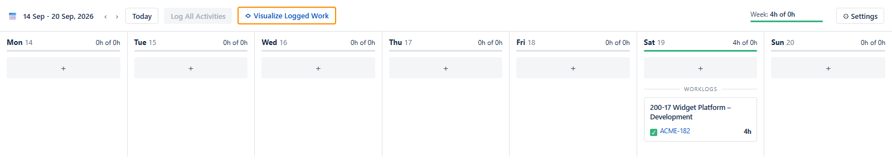

**Read what is there.** Writes nothing, so the week is whatever it already was — and this is the week the three cases after it act on.

```
> what did I log last week
```

```
2026-09-07 to 2026-09-13 — 9 worklogs, 40.00 hours total

  week of 2026-09-07                                 Mon 07  Tue 08  Wed 09  Thu 10  Fri 11
  -----------------------------------------------------------------------------------------
  LEAVE_VAC · Absence - Vacation (ACME-106)            8.00
  200-17 · Widget Platform – Development (ACME-182)            7.00    7.00    7.00    7.00
  200-16 · Widget Platform - Governance (ACME-177)             1.00    1.00    1.00    1.00
  day total                                            8.00    8.00    8.00    8.00    8.00
```

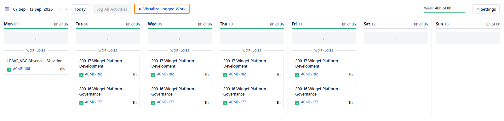

**Change an entry.** Set a work item's hours on one day.

```
> change 200-17 on Thursday to 6 hours
```

```
2026-09-10 to 2026-09-10 — 1 row across 1 date
0 rows are on a future date (today is 2026-09-14)

  week of 2026-09-07                                     Mon 07      Tue 08      Wed 09      Thu 10      Fri 11
  -------------------------------------------------------------------------------------------------------------
  200-17 · Widget Platform – Development (ACME-182)                                      7.00->6.00
  200-16 · Widget Platform - Governance (ACME-177)                                             1.00
  day total                                                                                    7.00
```


**Remove one.** Setting a work item to zero on a day deletes it.

```
> drop Friday's governance entry
```

```
2026-09-11 to 2026-09-11 — 1 row across 1 date
0 rows are on a future date (today is 2026-09-14)

  week of 2026-09-07                                     Mon 07      Tue 08      Wed 09      Thu 10      Fri 11
  -------------------------------------------------------------------------------------------------------------
  200-16 · Widget Platform - Governance (ACME-177)                                                   1.00->0.00
  200-17 · Widget Platform – Development (ACME-182)                                                        7.00
  day total                                                                                                7.00
```

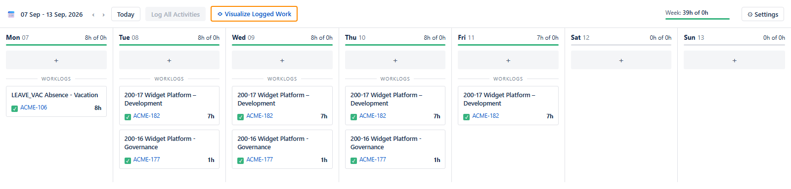

**Run the same thing twice.** Nothing stops you, and nothing needs to: the day total says what it would come to before you answer. This is what yes would leave behind — another eight-hour development record on every day, because a create adds a record rather than merging into one already there.

```
> fill in last week with 8 hours of ACME-182
```

```
2026-09-07 to 2026-09-11 — 5 rows across 5 dates
Excluded (weekend): 2 days (09-12 Sat, 09-13 Sun)
0 rows are on a future date (today is 2026-09-14)

  week of 2026-09-07                                      Mon 07       Tue 08       Wed 09       Thu 10       Fri 11
  ------------------------------------------------------------------------------------------------------------------
  200-17 · Widget Platform – Development (ACME-182)        +8.00  7.00->15.00  7.00->15.00  7.00->15.00  7.00->15.00
  LEAVE_VAC · Absence - Vacation (ACME-106)                 8.00
  200-16 · Widget Platform - Governance (ACME-177)                       1.00         1.00         1.00         1.00
  day total                                                16.00        16.00        16.00        16.00        16.00
```

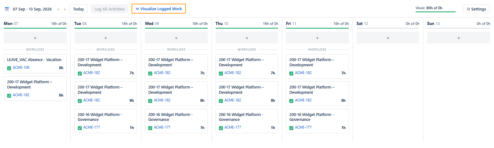

---

## What it will not do

- Submit or approve a timesheet.
- Detect public holidays.
- Move a worklog to another issue.
- Change anything in Jira.
- Cap how many hours a day can hold. The day total shows a long day before you confirm it, and whether it is right is yours to judge.

---

## Why it learns from your history

A write needs a numeric issue id and whatever work attributes your Tempo requires, such as an account. Nothing in the Tempo API turns a Jira key into any of them.

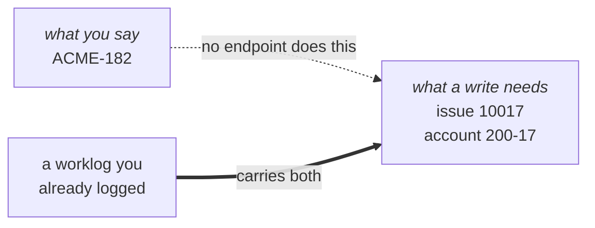

So the work items you can log against are the ones you have logged against before. A new one needs one worklog created in the Tempo UI — after that it appears here like any other.

---

## Safety

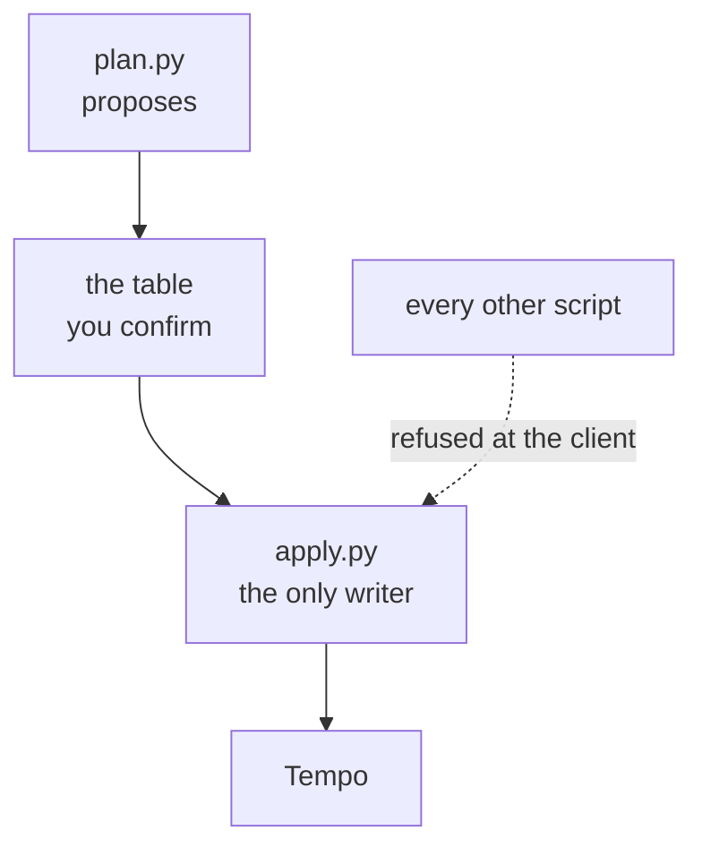

| | |
|---|---|
| One writer | the HTTP client exposes read and write as separate interfaces that refuse each other's endpoints |
| Re-checked | each row is verified against live state immediately before it is written |
| Recorded | every outcome is appended to a file as it happens, so a run cut short is still answerable |
| No overrides | `bypassPeriodClosuresAndApprovals` is implemented nowhere, which makes "never bypass a closed period" a fact rather than a rule |
| Token | read from file at call time, never from the environment or a command line, and never printed |

---

## Repository layout

```tree
plugins/tempo-logger/
├── .claude-plugin/plugin.json       plugin metadata
├── CLAUDE.md                        notes for working on the plugin
├── README.md                        this page, with its translations
├── docs/images/                     the pictures on this page
└── skills/tempo-logger/
    ├── SKILL.md                     what the model follows
    ├── scripts/
    │   ├── tempo.sh, tempo.cmd      wrappers that force UTF-8 from outside python
    │   ├── tempo.py                 HTTP, paging, failure classification, formatting
    │   ├── setup.py                 setup check and config
    │   ├── catalogue.py             work items from history, name-collision detection
    │   ├── show.py                  existing worklogs, in the same grid
    │   ├── plan.py                  proposal, grid, and confirmation text
    │   └── apply.py                 the only writer
    ├── tests/
    │   ├── tempo_logger_tests.py    checks on the guarantees above, offline
    │   ├── live_check.py            the same against your own Tempo, reading only
    │   └── contract.py              generates SKILL.md's factual tables from the code
    └── evals/                       what a model reading SKILL.md must do
```
