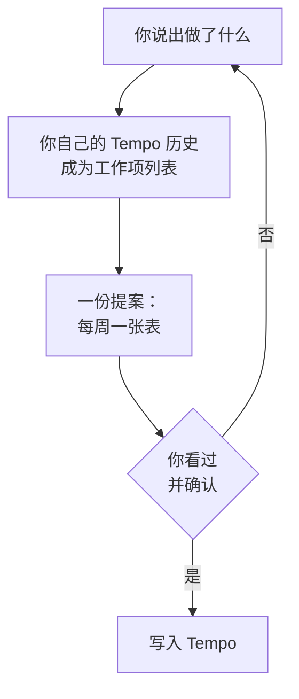
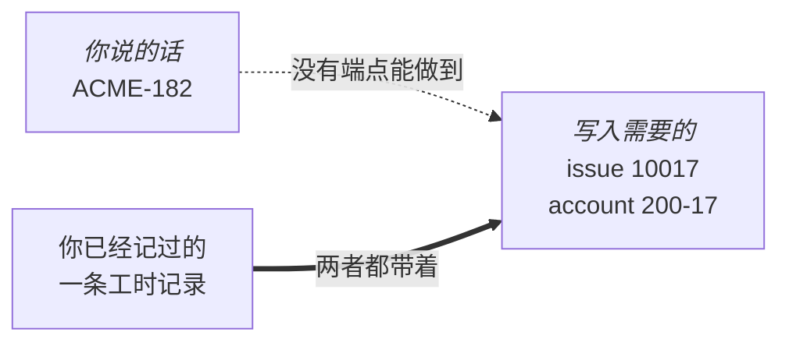
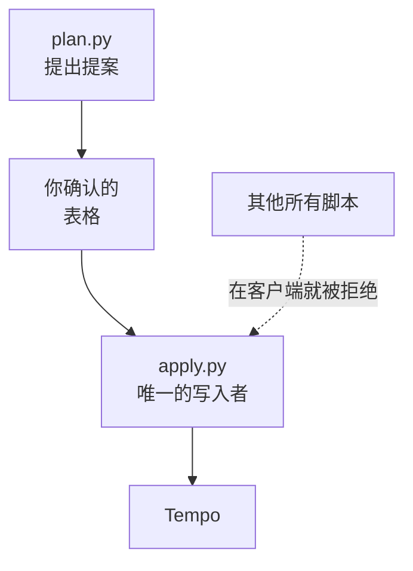

<!-- translated from README.md, source sha256 8f3f34b23b45ce774cfaa758e58eb00837c9f581d5794f5d175a9ae41aca8a33; see the root CLAUDE.md "Translations" before editing -->
# tempo-logger

[English](README.md) | [繁體中文](README.zh-TW.md) | [简体中文](README.zh-CN.md)

说出你做了什么，就能填好 Tempo 工时表。在你看过表格并确认之前，不会写入任何内容。

```
> fill in this week with 8 hours of ACME-182
```

```
2026-09-14 to 2026-09-18 — 5 rows across 5 dates
Excluded (weekend): 2 days (09-19 Sat, 09-20 Sun)
4 rows are on a future date (today is 2026-09-14)

  week of 2026-09-14                                 Mon 14  Tue 15  Wed 16  Thu 17  Fri 18
  -----------------------------------------------------------------------------------------
  200-17 · Widget Platform – Development (ACME-182)   +8.00   +8.00   +8.00   +8.00   +8.00
  day total                                            8.00    8.00    8.00    8.00    8.00
```

确认之后，Tempo 里的这一周就是这样：


本页的周视图都是按 Tempo 的版式绘制的示意图，工作项和 account 都是虚构的，并非真实工时表的截图。每张图上方的表格，是这个 plugin 用自己的版式呈现同一份虚构历史。

---

## 工作原理



这张表就是全部的安全机制。它列出会改动的每一天、每个工作项的时数，以及当天加起来的总数，所以某一天不知不觉变成十六小时，在发生之前就能看到，而不是事后才发现。

---

## 安装

这个 plugin 通过 `tundra` marketplace 发布。

```
/plugin marketplace add https://github.com/tundra-east/tundra.git
/plugin install tempo-logger@tundra
```

---

## 设置

只有一个步骤，从 Tempo 界面开始。从 Jira 侧边栏打开 **Tempo**，再点击 Tempo 面板底部的 **Settings**。在 **Data access** 下选择 **API Integration**，然后点击 **+ New Token**。


与本页的周视图不同，这张图是从真实的 Tempo 设置面板裁剪下来的。

把它给你的 token 保存为一个纯文本文件，文件里只有这一行：

| 平台 | Token 文件 |
|---|---|
| Linux, macOS | `~/.config/tempo/token.txt` |
| Windows | `%APPDATA%\tempo\token.txt` |

然后在你平时提出其他请求的同一个地方问：

```
> check my tempo setup
```

它会回答 `ready`，或明确指出缺了什么，包括空的工时表，这是它唯一无法替你解决的事。Tempo 没有任何端点能说明一个 token 属于谁，所以你的账号 id 是从你已经记过的一条工时记录里读出来的；一条都没有时，连读取都无法运行。在 Tempo 界面记一条，之后的一切就都能基于你的历史运行。

---

## 你可以怎么说

用你手头有的任何方式指代工作项都可以：它的 Jira key `ACME-182`、它的 account key `200-17`，或它的标题 `Widget Platform – Development`。匹配的不止一个时，它会问你是哪一个。下面每个例子依次是命令、请你确认的表格，以及确认之后 Tempo 里的那一周。

**记一整天，分到多个工作项。** 当天需要几个就分几个。

```
> log 7 hours of ACME-182 and 1 hour of ACME-177 every day this week
```

```
2026-09-14 to 2026-09-18 — 10 rows across 5 dates
Excluded (weekend): 2 days (09-19 Sat, 09-20 Sun)
8 rows are on a future date (today is 2026-09-14)

  week of 2026-09-14                                 Mon 14  Tue 15  Wed 16  Thu 17  Fri 18
  -----------------------------------------------------------------------------------------
  200-17 · Widget Platform – Development (ACME-182)   +7.00   +7.00   +7.00   +7.00   +7.00
  200-16 · Widget Platform - Governance (ACME-177)    +1.00   +1.00   +1.00   +1.00   +1.00
  day total                                            8.00    8.00    8.00    8.00    8.00
```


**用你自己的话指代。** 匹配不是文本搜索：大小写不同、只说出部分名称、拼错或换一种语言，都会落到同一个工作项上；可能是其中两个的，会回头问你，而不是去猜。

```
> log 8 hours on widget dev tomorrow
```

```
2026-09-15 to 2026-09-15 — 1 row across 1 date
1 row is a future date (today is 2026-09-14)

  week of 2026-09-14                                 Mon 14  Tue 15  Wed 16  Thu 17  Fri 18
  -----------------------------------------------------------------------------------------
  200-17 · Widget Platform – Development (ACME-182)           +8.00
  day total                                                    8.00
```


**填写更长的时间段。** 每周一张表，不管跨几周。

```
> log 8 hours on Widget Platform – Development for the three weeks after this one
```

```
2026-09-21 to 2026-10-09 — 15 rows across 15 dates
Excluded (weekend): 4 days (09-26 Sat, 09-27 Sun, 10-03 Sat, 10-04 Sun)
15 rows are on a future date (today is 2026-09-14)

  week of 2026-09-21                                 Mon 21  Tue 22  Wed 23  Thu 24  Fri 25
  -----------------------------------------------------------------------------------------
  200-17 · Widget Platform – Development (ACME-182)   +8.00   +8.00   +8.00   +8.00   +8.00
  day total                                            8.00    8.00    8.00    8.00    8.00

  week of 2026-09-28                                 Mon 28  Tue 29  Wed 30  Thu 01  Fri 02
  -----------------------------------------------------------------------------------------
  200-17 · Widget Platform – Development (ACME-182)   +8.00   +8.00   +8.00   +8.00   +8.00
  day total                                            8.00    8.00    8.00    8.00    8.00

  week of 2026-10-05                                 Mon 05  Tue 06  Wed 07  Thu 08  Fri 09
  -----------------------------------------------------------------------------------------
  200-17 · Widget Platform – Development (ACME-182)   +8.00   +8.00   +8.00   +8.00   +8.00
  day total                                            8.00    8.00    8.00    8.00    8.00
```

这三周中的第一周，另外两周看起来也一样：


**记周末的某一天。** 你点名的日期会按字面采用，星期六和星期日也一样。你说得模糊的时间段，例如“这周”、“九月”，只有在你自己的历史里已经有周末工作时，才会覆盖到周末。

```
> log 4 hours of ACME-182 on Saturday
```

```
2026-09-19 to 2026-09-19 — 1 row across 1 date
1 row is a future date (today is 2026-09-15)

  week of 2026-09-14                                 Mon 14  Tue 15  Wed 16  Thu 17  Fri 18  Sat 19
  -------------------------------------------------------------------------------------------------
  200-17 · Widget Platform – Development (ACME-182)                                           +4.00
  day total                                                                                    4.00
```


**读取已有的内容。** 不写入任何内容，所以这一周保持原样；后面三个例子操作的就是这一周。

```
> what did I log last week
```

```
2026-09-07 to 2026-09-13 — 9 worklogs, 40.00 hours total

  week of 2026-09-07                                 Mon 07  Tue 08  Wed 09  Thu 10  Fri 11
  -----------------------------------------------------------------------------------------
  LEAVE_VAC · Absence - Vacation (ACME-106)            8.00
  200-17 · Widget Platform – Development (ACME-182)            7.00    7.00    7.00    7.00
  200-16 · Widget Platform - Governance (ACME-177)             1.00    1.00    1.00    1.00
  day total                                            8.00    8.00    8.00    8.00    8.00
```


**修改一条。** 设定某个工作项在某一天的时数。

```
> change 200-17 on Thursday to 6 hours
```

```
2026-09-10 to 2026-09-10 — 1 row across 1 date
0 rows are on a future date (today is 2026-09-14)

  week of 2026-09-07                                     Mon 07      Tue 08      Wed 09      Thu 10      Fri 11
  -------------------------------------------------------------------------------------------------------------
  200-17 · Widget Platform – Development (ACME-182)                                      7.00->6.00
  200-16 · Widget Platform - Governance (ACME-177)                                             1.00
  day total                                                                                    7.00
```


**删除一条。** 把某一天的某个工作项设为零，就会删除它。

```
> drop Friday's governance entry
```

```
2026-09-11 to 2026-09-11 — 1 row across 1 date
0 rows are on a future date (today is 2026-09-14)

  week of 2026-09-07                                     Mon 07      Tue 08      Wed 09      Thu 10      Fri 11
  -------------------------------------------------------------------------------------------------------------
  200-16 · Widget Platform - Governance (ACME-177)                                                   1.00->0.00
  200-17 · Widget Platform – Development (ACME-182)                                                        7.00
  day total                                                                                                7.00
```


**同一件事运行两次。** 没有什么会拦住你，也不需要拦：在你回答之前，当天总数就已经说明结果会是多少。下面是确认之后会留下的样子：每一天都多了一条八小时的 Development 记录，因为创建会新增一条记录，而不是合并到已有的记录。

```
> fill in last week with 8 hours of ACME-182
```

```
2026-09-07 to 2026-09-11 — 5 rows across 5 dates
Excluded (weekend): 2 days (09-12 Sat, 09-13 Sun)
0 rows are on a future date (today is 2026-09-14)

  week of 2026-09-07                                      Mon 07       Tue 08       Wed 09       Thu 10       Fri 11
  ------------------------------------------------------------------------------------------------------------------
  200-17 · Widget Platform – Development (ACME-182)        +8.00  7.00->15.00  7.00->15.00  7.00->15.00  7.00->15.00
  LEAVE_VAC · Absence - Vacation (ACME-106)                 8.00
  200-16 · Widget Platform - Governance (ACME-177)                       1.00         1.00         1.00         1.00
  day total                                                16.00        16.00        16.00        16.00        16.00
```


---

## 它不做的事

- 提交或批准工时表。
- 识别法定节假日。
- 把工时记录移到另一个 issue。
- 修改 Jira 里的任何内容。
- 限制一天最多能记几小时。在你确认之前，当天总数就会显示这一天记得很长，对不对由你判断。

---

## 为什么它从你的历史中学习

一次写入需要数字形式的 issue id，以及你的 Tempo 要求的各项工作属性，例如 account。Tempo API 里没有任何东西能把 Jira key 转换成其中任何一项。



所以你能记工时的工作项，就是你以前记过的那些。新的工作项需要先在 Tempo 界面创建一条工时记录，之后它就会和其他工作项一样出现在这里。

---

## 安全性



| | |
|---|---|
| 唯一的写入者 | HTTP 客户端把读取和写入做成两个独立的接口，彼此拒绝对方的端点 |
| 写入前复查 | 每一行在写入前的一刻，都会对照实时状态再验证一次 |
| 留有记录 | 每个结果一发生就追加到文件里，所以中途被打断的运行仍然能查到结果 |
| 不提供绕过 | `bypassPeriodClosuresAndApprovals` 在任何地方都没有实现，所以“绝不绕过已关闭的期间”是事实，而不是规则 |
| Token | 在调用时从文件读取，绝不从环境变量或命令行读取，也绝不打印 |

---

## Repo 结构

```tree
plugins/tempo-logger/
├── .claude-plugin/plugin.json       plugin 的元数据
├── CLAUDE.md                        维护这个 plugin 时的说明
├── README.md                        这一页，以及它的翻译
├── docs/images/                     这一页的图片
└── skills/tempo-logger/
    ├── SKILL.md                     模型遵循的指示
    ├── scripts/
    │   ├── tempo.sh, tempo.cmd      从 python 外部强制使用 UTF-8 的包装脚本
    │   ├── tempo.py                 HTTP、分页、失败分类、格式化
    │   ├── setup.py                 设置检查与配置文件
    │   ├── catalogue.py             从历史记录找出工作项、检测名称冲突
    │   ├── show.py                  已有的工时记录，用同一种表格呈现
    │   ├── plan.py                  提案、表格与确认文字
    │   └── apply.py                 唯一的写入者
    ├── tests/
    │   ├── tempo_logger_tests.py    离线检查上述各项保证
    │   ├── live_check.py            对你自己的 Tempo 做同样的检查，只读取
    │   └── contract.py              从代码生成 SKILL.md 里的事实表格
    └── evals/                       模型读了 SKILL.md 之后必须做到的事
```
