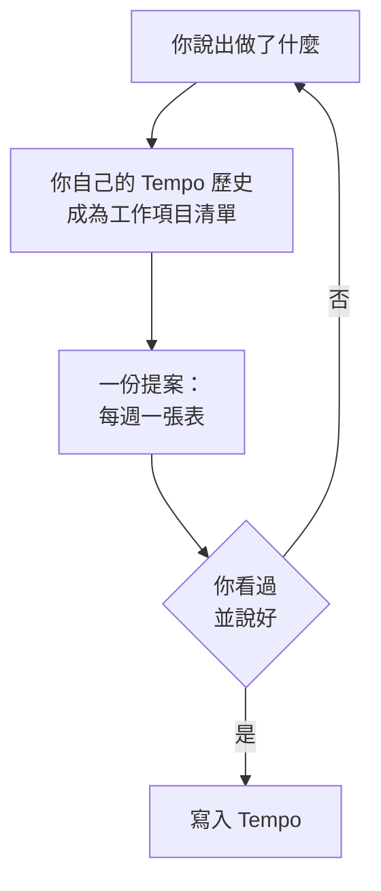
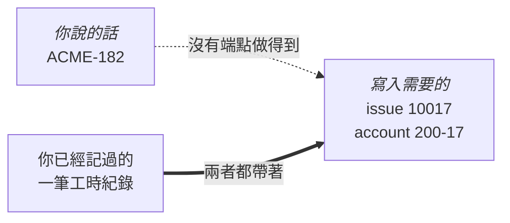
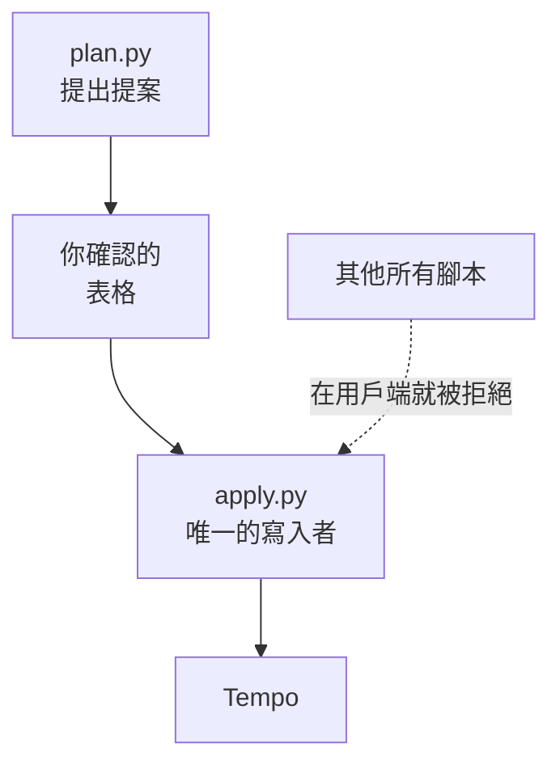

<!-- translated from README.md, source sha256 8f3f34b23b45ce774cfaa758e58eb00837c9f581d5794f5d175a9ae41aca8a33; see the root CLAUDE.md "Translations" before editing -->
# tempo-logger

[English](README.md) | [繁體中文](README.zh-TW.md) | [简体中文](README.zh-CN.md)

說出你做了什麼，就能填好 Tempo 工時表。在你看過表格並說好之前，什麼都不會寫入。

```
> fill in this week with 8 hours of ACME-182
```

```
2026-09-14 to 2026-09-18 — 5 rows across 5 dates
Excluded (weekend): 2 days (09-19 Sat, 09-20 Sun)
4 rows are on a future date (today is 2026-09-14)

  week of 2026-09-14                                 Mon 14  Tue 15  Wed 16  Thu 17  Fri 18
  -----------------------------------------------------------------------------------------
  200-17 · Widget Platform – Development (ACME-182)   +8.00   +8.00   +8.00   +8.00   +8.00
  day total                                            8.00    8.00    8.00    8.00    8.00
```

說好之後，Tempo 裡的這一週就是這樣：


本頁的週檢視都是依 Tempo 版面畫出的示意圖，工作項目和 account 都是虛構的，並非真實工時表的截圖。每張圖上方的表格，是這個 plugin 以自己的版面呈現同一份虛構歷史。

---

## 運作方式



這張表就是全部的安全機制。它列出會動到的每一天、每個工作項目的時數，以及當天加起來的總數，所以某一天不知不覺變成十六小時，會在發生之前就看得到，而不是事後才發現。

---

## 安裝

這個 plugin 由 `tundra` marketplace 發佈。

```
/plugin marketplace add https://github.com/tundra-east/tundra.git
/plugin install tempo-logger@tundra
```

---

## 設定

只有一個步驟，從 Tempo 介面開始。從 Jira 側邊欄打開 **Tempo**，再點 Tempo 面板底部的 **Settings**。在 **Data access** 底下選 **API Integration**，然後點 **+ New Token**。


和本頁的週檢視不同，這張圖是從真實的 Tempo 設定面板裁切下來的。

把它給你的 token 存成一個純文字檔，檔案裡只有這一行：

| 平台 | Token 檔案 |
|---|---|
| Linux, macOS | `~/.config/tempo/token.txt` |
| Windows | `%APPDATA%\tempo\token.txt` |

然後在你平常提出其他要求的同一個地方問：

```
> check my tempo setup
```

它會回答 `ready`，或明確指出缺了什麼，包括空的工時表，這是它唯一無法替你解決的事。Tempo 沒有任何端點能說出一個 token 屬於誰，所以你的帳號 id 是從你已經記過的一筆工時紀錄讀出來的；一筆都沒有時，連讀取都無法執行。在 Tempo 介面記一筆，之後的一切就都能從你的歷史運作。

---

## 你可以怎麼說

用你手邊有的任何方式指稱工作項目都可以：它的 Jira key `ACME-182`、它的 account key `200-17`，或它的標題 `Widget Platform – Development`。符合的不只一個時，它會問你是哪一個。下面每個例子依序是指令、請你確認的表格，以及確認之後 Tempo 裡的那一週。

**記一整天，分配到多個工作項目。** 當天需要幾個就分幾個。

```
> log 7 hours of ACME-182 and 1 hour of ACME-177 every day this week
```

```
2026-09-14 to 2026-09-18 — 10 rows across 5 dates
Excluded (weekend): 2 days (09-19 Sat, 09-20 Sun)
8 rows are on a future date (today is 2026-09-14)

  week of 2026-09-14                                 Mon 14  Tue 15  Wed 16  Thu 17  Fri 18
  -----------------------------------------------------------------------------------------
  200-17 · Widget Platform – Development (ACME-182)   +7.00   +7.00   +7.00   +7.00   +7.00
  200-16 · Widget Platform - Governance (ACME-177)    +1.00   +1.00   +1.00   +1.00   +1.00
  day total                                            8.00    8.00    8.00    8.00    8.00
```


**用你自己的話指稱。** 比對不是文字搜尋：大小寫不同、只說出部分名稱、打錯字或換一種語言，都會對到同一個工作項目；可能是其中兩個的，會回頭問你，而不是用猜的。

```
> log 8 hours on widget dev tomorrow
```

```
2026-09-15 to 2026-09-15 — 1 row across 1 date
1 row is a future date (today is 2026-09-14)

  week of 2026-09-14                                 Mon 14  Tue 15  Wed 16  Thu 17  Fri 18
  -----------------------------------------------------------------------------------------
  200-17 · Widget Platform – Development (ACME-182)           +8.00
  day total                                                    8.00
```


**填一段較長的期間。** 每週一張表，不管跨幾週。

```
> log 8 hours on Widget Platform – Development for the three weeks after this one
```

```
2026-09-21 to 2026-10-09 — 15 rows across 15 dates
Excluded (weekend): 4 days (09-26 Sat, 09-27 Sun, 10-03 Sat, 10-04 Sun)
15 rows are on a future date (today is 2026-09-14)

  week of 2026-09-21                                 Mon 21  Tue 22  Wed 23  Thu 24  Fri 25
  -----------------------------------------------------------------------------------------
  200-17 · Widget Platform – Development (ACME-182)   +8.00   +8.00   +8.00   +8.00   +8.00
  day total                                            8.00    8.00    8.00    8.00    8.00

  week of 2026-09-28                                 Mon 28  Tue 29  Wed 30  Thu 01  Fri 02
  -----------------------------------------------------------------------------------------
  200-17 · Widget Platform – Development (ACME-182)   +8.00   +8.00   +8.00   +8.00   +8.00
  day total                                            8.00    8.00    8.00    8.00    8.00

  week of 2026-10-05                                 Mon 05  Tue 06  Wed 07  Thu 08  Fri 09
  -----------------------------------------------------------------------------------------
  200-17 · Widget Platform – Development (ACME-182)   +8.00   +8.00   +8.00   +8.00   +8.00
  day total                                            8.00    8.00    8.00    8.00    8.00
```

這三週的第一週，另外兩週看起來也一樣：


**記週末的某一天。** 你指名的日期會照字面採用，星期六和星期日也一樣。你說得模糊的期間，例如「這週」、「九月」，只有在你自己的歷史裡已經有週末工作時，才會涵蓋到週末。

```
> log 4 hours of ACME-182 on Saturday
```

```
2026-09-19 to 2026-09-19 — 1 row across 1 date
1 row is a future date (today is 2026-09-15)

  week of 2026-09-14                                 Mon 14  Tue 15  Wed 16  Thu 17  Fri 18  Sat 19
  -------------------------------------------------------------------------------------------------
  200-17 · Widget Platform – Development (ACME-182)                                           +4.00
  day total                                                                                    4.00
```


**讀取已有的內容。** 什麼都不寫入，所以這一週維持原本的樣子；後面三個例子操作的，就是這一週。

```
> what did I log last week
```

```
2026-09-07 to 2026-09-13 — 9 worklogs, 40.00 hours total

  week of 2026-09-07                                 Mon 07  Tue 08  Wed 09  Thu 10  Fri 11
  -----------------------------------------------------------------------------------------
  LEAVE_VAC · Absence - Vacation (ACME-106)            8.00
  200-17 · Widget Platform – Development (ACME-182)            7.00    7.00    7.00    7.00
  200-16 · Widget Platform - Governance (ACME-177)             1.00    1.00    1.00    1.00
  day total                                            8.00    8.00    8.00    8.00    8.00
```


**修改一筆。** 設定某個工作項目在某一天的時數。

```
> change 200-17 on Thursday to 6 hours
```

```
2026-09-10 to 2026-09-10 — 1 row across 1 date
0 rows are on a future date (today is 2026-09-14)

  week of 2026-09-07                                     Mon 07      Tue 08      Wed 09      Thu 10      Fri 11
  -------------------------------------------------------------------------------------------------------------
  200-17 · Widget Platform – Development (ACME-182)                                      7.00->6.00
  200-16 · Widget Platform - Governance (ACME-177)                                             1.00
  day total                                                                                    7.00
```


**刪除一筆。** 把某一天的某個工作項目設為零，就會刪除它。

```
> drop Friday's governance entry
```

```
2026-09-11 to 2026-09-11 — 1 row across 1 date
0 rows are on a future date (today is 2026-09-14)

  week of 2026-09-07                                     Mon 07      Tue 08      Wed 09      Thu 10      Fri 11
  -------------------------------------------------------------------------------------------------------------
  200-16 · Widget Platform - Governance (ACME-177)                                                   1.00->0.00
  200-17 · Widget Platform – Development (ACME-182)                                                        7.00
  day total                                                                                                7.00
```


**同一件事執行兩次。** 沒有東西會擋你，也不需要擋：在你回答之前，當天總數就已經說明結果會是多少。下面是說好之後會留下的樣子：每一天都多了一筆八小時的 Development 紀錄，因為建立會新增一筆紀錄，而不是併入已經存在的紀錄。

```
> fill in last week with 8 hours of ACME-182
```

```
2026-09-07 to 2026-09-11 — 5 rows across 5 dates
Excluded (weekend): 2 days (09-12 Sat, 09-13 Sun)
0 rows are on a future date (today is 2026-09-14)

  week of 2026-09-07                                      Mon 07       Tue 08       Wed 09       Thu 10       Fri 11
  ------------------------------------------------------------------------------------------------------------------
  200-17 · Widget Platform – Development (ACME-182)        +8.00  7.00->15.00  7.00->15.00  7.00->15.00  7.00->15.00
  LEAVE_VAC · Absence - Vacation (ACME-106)                 8.00
  200-16 · Widget Platform - Governance (ACME-177)                       1.00         1.00         1.00         1.00
  day total                                                16.00        16.00        16.00        16.00        16.00
```


---

## 它不做的事

- 送出或核准工時表。
- 偵測國定假日。
- 把工時紀錄移到另一個 issue。
- 修改 Jira 裡的任何東西。
- 限制一天最多能記幾小時。在你確認之前，當天總數就會顯示這一天記得很長，對不對由你判斷。

---

## 為什麼它從你的歷史學習

一次寫入需要數字形式的 issue id，以及你的 Tempo 要求的各種工作屬性，例如 account。Tempo API 裡沒有任何東西能把 Jira key 轉成其中任何一個。



所以你能記工時的工作項目，就是你以前記過的那些。新的工作項目需要先在 Tempo 介面建立一筆工時紀錄，之後它就會和其他工作項目一樣出現在這裡。

---

## 安全性



| | |
|---|---|
| 唯一的寫入者 | HTTP 用戶端把讀取和寫入做成兩個分開的介面，彼此拒絕對方的端點 |
| 寫入前再查一次 | 每一列在寫入前一刻，都會對照即時狀態再驗證一次 |
| 留下紀錄 | 每個結果一發生就附加到檔案裡，所以中途被打斷的執行仍然查得到結果 |
| 不提供繞過 | `bypassPeriodClosuresAndApprovals` 在任何地方都沒有實作，所以「絕不繞過已關閉的期間」是事實，而不是規則 |
| Token | 在呼叫當下從檔案讀取，絕不從環境變數或命令列讀取，也絕不印出 |

---

## Repo 結構

```tree
plugins/tempo-logger/
├── .claude-plugin/plugin.json       plugin 的中繼資料
├── CLAUDE.md                        維護這個 plugin 時的說明
├── README.md                        這一頁，以及它的翻譯
├── docs/images/                     這一頁的圖片
└── skills/tempo-logger/
    ├── SKILL.md                     模型遵循的指示
    ├── scripts/
    │   ├── tempo.sh, tempo.cmd      從 python 外部強制使用 UTF-8 的包裝腳本
    │   ├── tempo.py                 HTTP、分頁、失敗分類、格式化
    │   ├── setup.py                 設定檢查與設定檔
    │   ├── catalogue.py             從歷史紀錄找出工作項目、偵測名稱衝突
    │   ├── show.py                  既有的工時紀錄，用同一種表格呈現
    │   ├── plan.py                  提案、表格與確認文字
    │   └── apply.py                 唯一的寫入者
    ├── tests/
    │   ├── tempo_logger_tests.py    離線檢查上述各項保證
    │   ├── live_check.py            對你自己的 Tempo 做同樣的檢查，只讀取
    │   └── contract.py              從程式碼產生 SKILL.md 裡的事實表格
    └── evals/                       模型讀了 SKILL.md 之後必須做到的事
```
