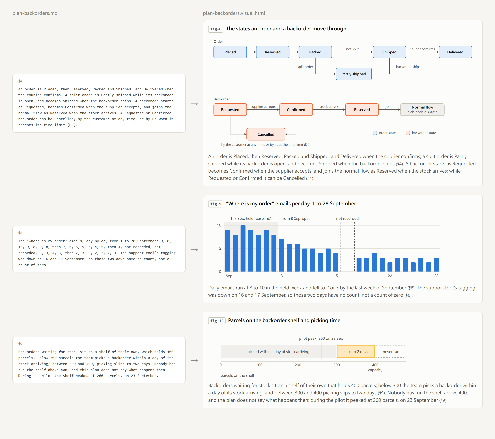
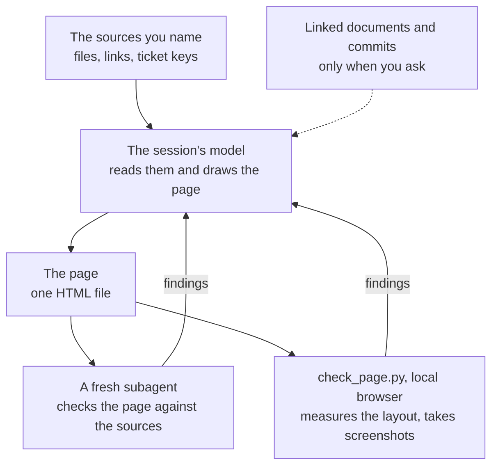

# visualise-document

[English](README.md) | [繁體中文](README.zh-TW.md) | [简体中文](README.zh-CN.md)

Turns a document, or several read together, into a local HTML page you can read in place of the source. Anything with a shape, such as a flow, a set of states, a choice between options, numbers over time or a set of limits, becomes a figure, and the rest becomes concise text that keeps every reason and condition, with the source's contradictions marked. It works on a plan, a spec, a design note, a ticket, a wiki page or a log.

<picture>
  <source media="(prefers-color-scheme: dark)" srcset="docs/before-after-dark.png">
  
</picture>

The pictures on this page come from a fictional plan, a bookshop's change to how it ships an order with a title out of stock. Each page is drawn by the model from its source, choosing each figure's form from what the passage says, so the same document can come out with different figures from one run to the next; the English, Traditional Chinese and Simplified Chinese pictures are three separate runs over the same plan.

## Install

```
/plugin marketplace add https://github.com/tundra-east/tundra.git
/plugin install visualise-document@tundra
```

Run `/reload-plugins` afterwards to activate it.

## Use

Ask in your own words, such as "visualise this plan" with a file, or run `/visualise-document:visualise-document` with one or more paths, links or ticket keys. In the same request you can also:

- name a language if the page should not be in your usual one
- ask for several sources "as one page" to combine them
- ask for "its linked documents", or name a commit, to have those read too; otherwise a linked page, ticket or commit the source mentions is listed on the page as not read

The page is written beside a local document, such as `plan.visual.html` for `plan.md`, and a page for the same document in another language beside that one, such as `plan.visual.zh-tw.html`. For a remote source or a combined page, the skill proposes a folder for you to confirm. Run it again after the document changes, and it keeps what still holds and redraws the rest.

## What it reads and what it sends



It reads only the sources you name, and lists on the page anything in them it could not read, such as an image or an attachment. A remote one is fetched with whatever tool the session has for it, such as an MCP server for your wiki or tracker; when none can reach it, the skill says so and stops. The model your session runs on reads the sources, and the checking subagent reads them again, so their content goes wherever that model runs, the same way a file does when you ask Claude to read it.

It writes one HTML file and never edits a source. The page ends with a line saying this plugin generated it, linked to this README, so anyone you pass it to can find the plugin. The page names people, customers and accounts by their role, never shows a credential, and is self-contained, apart from a script library it loads from a CDN when a figure uses one. The layout checks run a browser on this machine against a copy of the page.

## Requirements

Claude Code v2.1.221 or later, for the `artifact-diagramming` and `dataviz` skills it draws with. `artifact-diagramming` comes only with Artifacts, which are not available with an API key, Bedrock, Vertex, Foundry or `claude -p`, and either skill can be turned off; without one the page is drawn by the skill's own fallback rules, and without `dataviz` it keeps to a fixed set of colours and says that the palette was not validated.

Python 3.9 or later and a Chromium-family browser, Chrome, Edge, Chromium or Brave, for the layout checks and screenshots. Without a browser the page is checked from its markup alone, and the skill says so.
