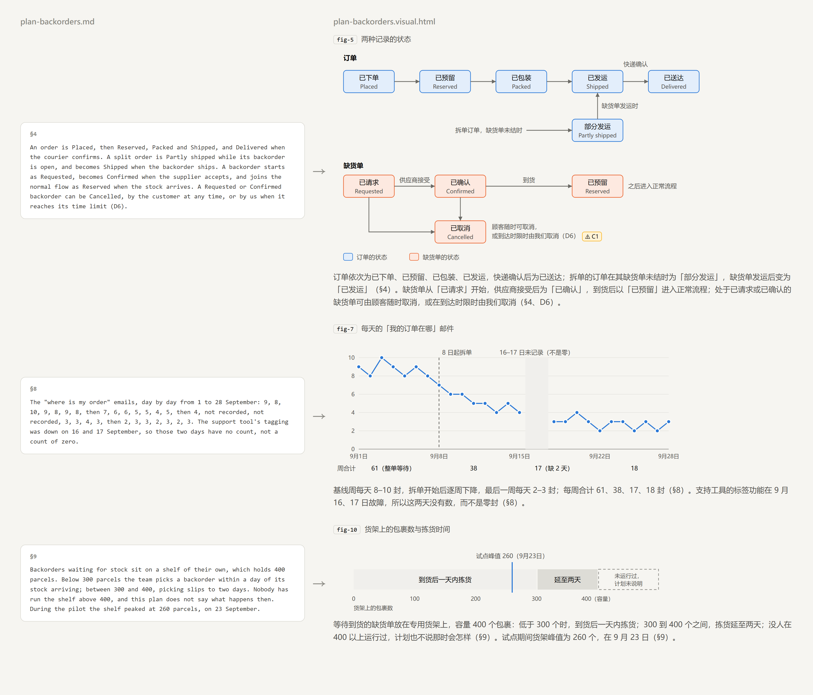
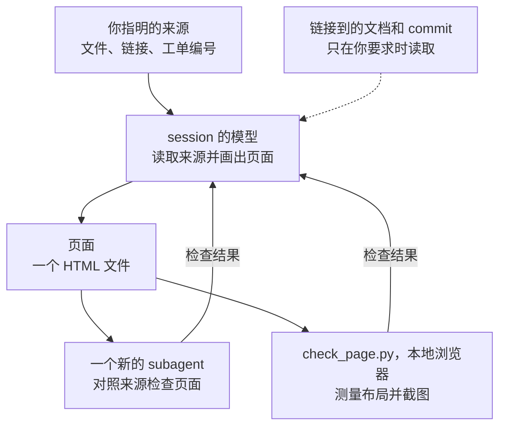

<!-- translated from README.md, source sha256 d4a8d3237d6c7c3b264bb27efba50bf0cf7793b4e6f751e749776770875b0301; see the root CLAUDE.md "Translations" before editing -->
# visualise-document

[English](README.md) | [繁體中文](README.zh-TW.md) | [简体中文](README.zh-CN.md)

把一份文档，或几份一起读的文档，变成一个本地的 HTML 页面，读了它就不必再读原文：凡是有形状的内容，例如一段流程、一组状态、几个选项之间的取舍、随时间变化的数字或一组上限，都画成图；其余写成精简的文字，保留每一个理由和条件，并标出来源里的矛盾。计划、规格、设计笔记、工单、wiki 页面或 log 都可以。

<picture>
  <source media="(prefers-color-scheme: dark)" srcset="docs/before-after-dark.zh-CN.png">
  
</picture>

这一页的图片取自一份虚构的计划：一家书店改变订单中有一本书缺货时的发货方式。每个页面都是模型依据来源画出的，每张图的形式由那一段内容决定，所以同一份文档每次运行画出的图可能不同；英文、繁体中文和简体中文的图片，是同一份计划的三次运行。

## 安装

```
/plugin marketplace add https://github.com/tundra-east/tundra.git
/plugin install visualise-document@tundra
```

安装后运行 `/reload-plugins` 启用它。

## 使用方法

用你自己的话提出，例如附上一个文件说“把这份计划画成页面”，或运行 `/visualise-document:visualise-document`，后面接一个或多个路径、链接或工单编号。也可以在同一个请求里提出：

- 页面不用你平时的语言时，指明要哪一种
- 要把几份来源合成一页，就说“合成一页”
- 要一并读它链接到的文档或某个 commit，就说“它链接到的文档”，或指明那个 commit；否则来源提到的链接页面、工单或 commit 会在页面上列为未读

页面放在本地文档旁边，例如 `plan.md` 的页面是 `plan.visual.html`。来源在远程或是合成页时，skill 会建议一个文件夹，由你确认。文档改了之后再运行一次，仍然成立的部分会保留，其余重画。

## 它读取什么、发送什么



它只读你指明的来源，其中读不到的内容，例如图片或附件，会列在页面上。远程的来源用 session 里能读取它的工具获取，例如连接到你的 wiki 或跟踪系统的 MCP server；没有工具读得到时，skill 会说明并停下。你的 session 所用的模型会读取来源，负责检查的 subagent 也会再读一次，所以来源的内容会发送到那个模型运行的地方，就和你请 Claude 读一个文件时一样。

它只写一个 HTML 文件，从不修改来源。页面以角色称呼人、客户和账户，从不显示凭据，而且是独立的文件，只有在某张图用到脚本库时，才会从 CDN 加载。布局检查会在这台机器上用浏览器打开页面的副本。

## 要求

Claude Code v2.1.221 或更新版本，因为它画图时使用 `artifact-diagramming` 和 `dataviz` 这两个 skill。`artifact-diagramming` 只随 Artifacts 提供，而 Artifacts 在使用 API key、Bedrock、Vertex、Foundry 或 `claude -p` 时都无法使用，两个 skill 也都可能被关闭；缺了其中一个时，页面会改用这个 skill 自己的备用规则来画，缺了 `dataviz` 时只用一组固定的颜色，并注明色板未经验证。

布局检查和截图需要 Python 3.9 或更新版本，以及一个 Chromium 系的浏览器：Chrome、Edge、Chromium 或 Brave。没有浏览器时，只从页面的标记检查，skill 也会说明这一点。
