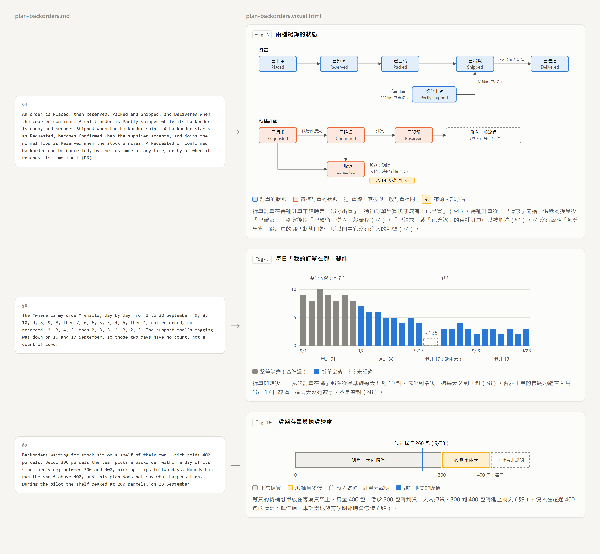
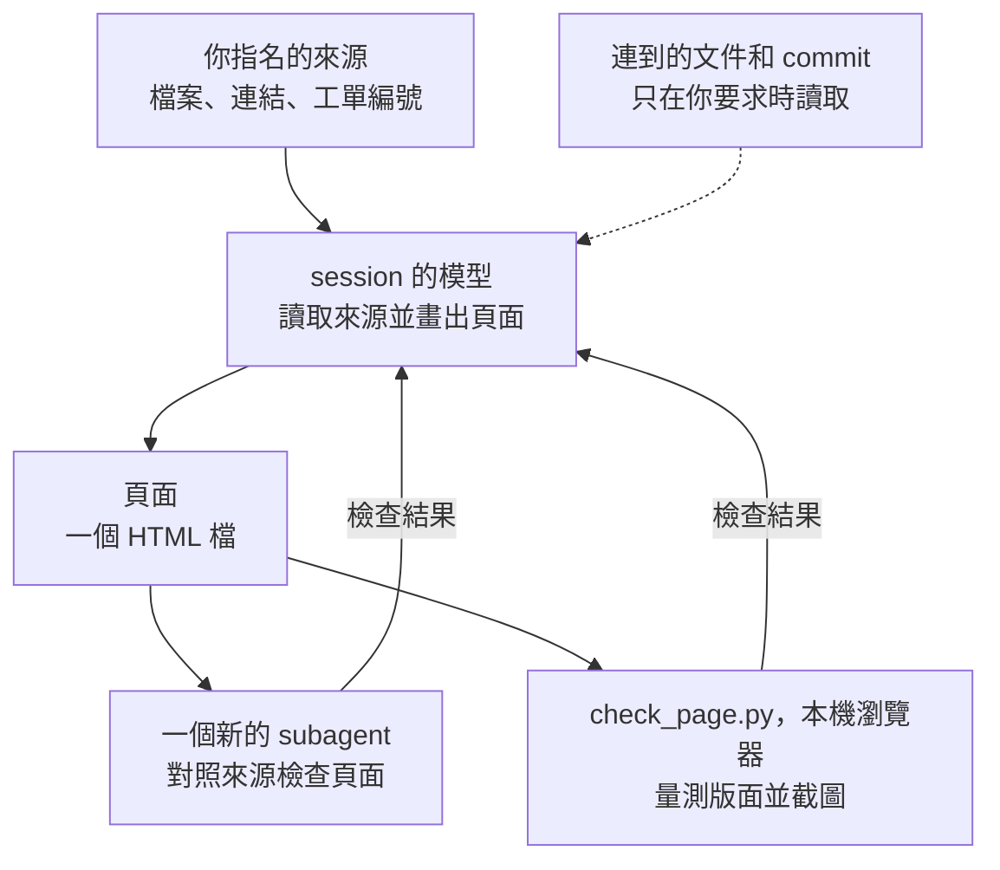

<!-- translated from README.md, source sha256 d3a6ad9cd7e72f6067d7002b17a5cb7a2a4214b8d5d1cc457f404cc60950a398; see the root CLAUDE.md "Translations" before editing -->
# visualise-document

[English](README.md) | [繁體中文](README.zh-TW.md) | [简体中文](README.zh-CN.md)

把一份文件，或幾份一起讀的文件，變成一個本機的 HTML 頁面，讀了它就不必再讀原文：凡是有形狀的內容，例如一段流程、一組狀態、幾個選項之間的取捨、隨時間變化的數字或一組上限，都畫成圖；其餘寫成精簡的文字，保留每一個理由和條件，並標出來源裡的矛盾。計畫、規格、設計筆記、工單、wiki 頁面或 log 都可以。

<picture>
  <source media="(prefers-color-scheme: dark)" srcset="docs/before-after-dark.zh-TW.png">
  
</picture>

這一頁的圖片取自一份虛構的計畫：一家書店改變訂單中有一本書缺貨時的出貨方式。每個頁面都是模型依來源畫出的，每張圖的形式由那一段內容決定，所以同一份文件每次執行畫出的圖可能不同；英文、繁體中文和簡體中文的圖片，是同一份計畫的三次執行。

## 安裝

```
/plugin marketplace add https://github.com/tundra-east/tundra.git
/plugin install visualise-document@tundra
```

安裝後執行 `/reload-plugins` 啟用它。

## 使用方式

用你自己的話提出，例如附上一個檔案說「把這份計畫畫成頁面」，或執行 `/visualise-document:visualise-document`，後面接一個或多個路徑、連結或工單編號。也可以在同一個請求裡提出：

- 頁面不用你平常的語言時，指名要哪一種
- 要把幾份來源合成一頁，就說「合成一頁」
- 要一併讀它連到的文件或某個 commit，就說「它連到的文件」，或指名那個 commit；否則來源提到的連結頁面、工單或 commit 會在頁面上列為未讀

頁面放在本機文件旁邊，例如 `plan.md` 的頁面是 `plan.visual.html`；同一份文件另一種語言的頁面放在它旁邊，例如 `plan.visual.zh-tw.html`。來源在遠端或是合成頁時，skill 會建議一個資料夾，由你確認。文件改了之後再執行一次，仍然成立的部分會保留，其餘重畫。

## 它讀什麼、送出什麼



它只讀你指名的來源，其中讀不到的內容，例如圖片或附件，會列在頁面上。遠端的來源用 session 裡能讀取它的工具抓取，例如連到你的 wiki 或追蹤系統的 MCP server；沒有工具讀得到時，skill 會說明並停下。你的 session 所用的模型會讀取來源，負責檢查的 subagent 也會再讀一次，所以來源的內容會送到那個模型運作的地方，就和你請 Claude 讀一個檔案時一樣。

它只寫一個 HTML 檔，從不修改來源。頁面最後有一行說明本頁由這個 plugin 產生，並連結到這份 README，讓收到頁面的人也找得到這個 plugin。頁面以角色稱呼人、客戶和帳戶，從不顯示憑證，而且是獨立的檔案，只有在某張圖用到腳本函式庫時，才會從 CDN 載入。版面檢查會在這台機器上用瀏覽器開啟頁面的複本。

## 需求

Claude Code v2.1.221 或更新版本，因為它畫圖時使用 `artifact-diagramming` 和 `dataviz` 這兩個 skill。`artifact-diagramming` 只隨 Artifacts 提供，而 Artifacts 在使用 API key、Bedrock、Vertex、Foundry 或 `claude -p` 時都無法使用，兩個 skill 也都可能被關閉；少了其中一個時，頁面會改用這個 skill 自己的備援規則來畫，少了 `dataviz` 時只用一組固定的顏色，並註明色盤未經驗證。

版面檢查和截圖需要 Python 3.9 或更新版本，以及一個 Chromium 系的瀏覽器：Chrome、Edge、Chromium 或 Brave。沒有瀏覽器時，只從頁面的標記檢查，skill 也會說明這一點。
